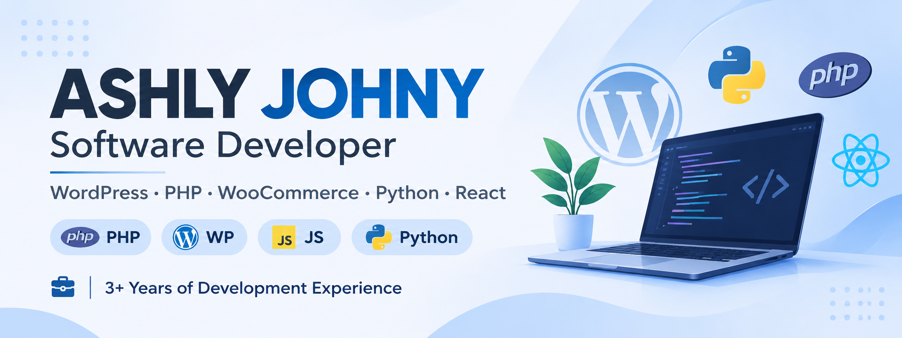

  

**Hi, I'm Ashly Johny 👋**

**Software Developer | WordPress & PHP Developer | WooCommerce Specialist**

Software Developer with 3+ years of professional experience in WordPress, PHP and WooCommerce development. I enjoy building practical web applications, developing custom plugins, integrating REST APIs and improving existing software products.

My experience includes contributing to WooCommerce products, developing backend functionality, working with frontend technologies and supporting software releases. I also hold a Python Full Stack Development certification, with academic and certification projects covering web application development.

Currently exploring new technologies and building Elayaji, a personal project focused on cardamom.

**Technical Skills**

**Backend Development**
* PHP
* Python
* REST API Integration

**Frontend Development**
* HTML5
* CSS3
* JavaScript
* React

**CMS & E-commerce**
* WordPress
* WooCommerce
* WordPress Plugin Development

**Tools & Technologies**
* Git & GitHub
* GitLab
* MySQL
* API Testing
* Debugging & Troubleshooting

**Professional Experience**

**WordPress & WooCommerce Development**
**3+ Years of Professional Development Experience**
Contributed to the development and maintenance of WordPress and WooCommerce products, with a focus on plugin development, integrations, backend functionality and production improvements.

**Products I've Contributed To:**
* **Notiqoo** – WhatsApp integration and automation for WooCommerce, including order notifications and customer communication.
* **Order Approval for WooCommerce** – WooCommerce order approval workflows and related functionality.
* **Teams for Notiqoo** – Team collaboration and shared WhatsApp inbox functionality.
* **Automator for Notiqoo** – Workflow automation and notification management for WooCommerce.

**Responsibilities & Contributions**

* WordPress and WooCommerce plugin development.
* PHP backend development and frontend enhancements.
* REST API integration and API-related development.
* JavaScript, HTML and CSS implementation.
* Bug fixing, debugging and production issue resolution.
* Feature development, testing and maintenance.
* GitLab-based development workflows and software releases.

**Featured Projects**

**1. Vroom – Real-Time Bus Tracking System**

An academic project focused on real-time bus tracking, helping users access bus location information and improve public transportation tracking.

Type: Academic Project

**2. SHG – Self-Help Group Web Application**

A web application developed as an academic project to support Self-Help Groups through digital management and organized information handling.

Type: Academic Project

**3. Elayaji – Cardamom Project**

A personal project currently under development, focused on cardamom-related business operations and digital solutions.

Type: Personal Project | In Progress

**4. Tourism Management Application**

A web application developed as part of my Python Full Stack Development certification, focused on tourism-related information and management.

Type: Certification Project

**5. Student Management System**

A project developed during my Python Full Stack Development certification to explore student information management and web application development.

Type: Certification Project

**Education & Certifications**

* Master of Computer Applications (MCA) – 2021–2023 | First Class with Distinction
* Bachelor of Computer Applications (BCA)
* Python Full Stack Development Certification

**Currently Learning & Exploring**

* Advanced WordPress and WooCommerce development.
* Python backend development and full-stack application development.
* React and modern frontend technologies.
* REST API development and integration.
* Scalable web application architecture.

**Let's Connect**

I'm interested in software development opportunities, collaborative projects and learning new technologies.

- GitHub: https://github.com/ashlynjohny/
- LinkedIn:https://www.linkedin.com/in/ashly-sipil/
- Email: ashlynjohny@gmail.com

**Thanks for visiting my profile!**
